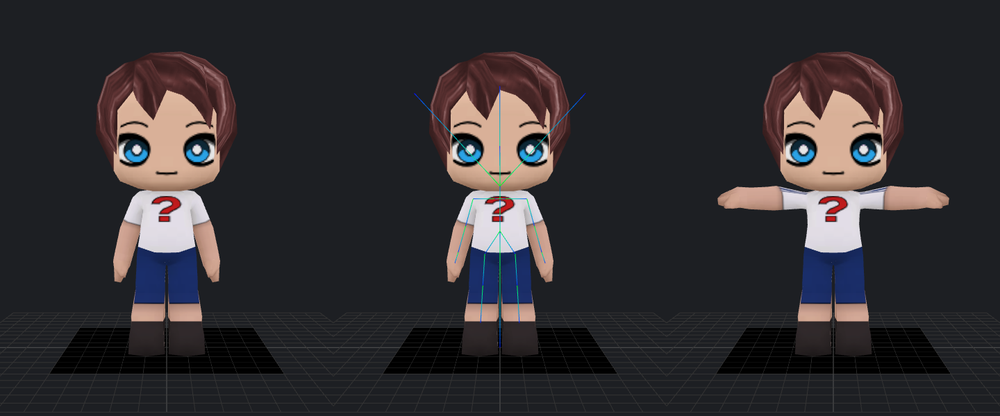

# BuddyPoke 3D Character Studio — Repository Analysis & Implementation Plan

Status: **Phase 1 complete (analysis + feasibility spike). No application code has been written or changed yet.**
Repository analysed: `FilipeHSAraujo/BuddyRevival` @ `62147c3` (11 commits, MIT code / Buddy Labs assets).

---

## 1. What the repository is

A dependency-free, build-free ES-module app (`web/`, ~3,000 lines of JS) that decodes the original BuddyPoke
`.bin` packages and draws them with a **Canvas 2D software renderer** (painter's algorithm, affine-textured triangles).
`EXPORTED/` is a JPEXS dump of the original SWF (ActionScript in `EXPORTED/scripts/com/buddylabs/player`, ~9.5k lines),
used as reference only. `tests/engine.test.mjs` is a Node regression test with signatures taken from the original Flash player
(passes: `node tests/engine.test.mjs` → `ok`).

Layering (strict, lower layers never import upper ones):

| Layer | Files | Role | Browser-only APIs |
|---|---|---|---|
| engine | `amf3.js`, `binary.js`, `package.js`, `mesh-decoder.js`, `mesh.js`, `skin.js`, `scene-graph.js`, `animation.js`, `math.js`, `material.js`, `renderer.js` | bytes → scene graph, meshes, skins, animation; Canvas 2D drawing | `DecompressionStream` (Node 18+ has it), `DOMMatrix` (renderer/mesh only) |
| domain | `buddy.js`, `catalog.js`, `textures.js`, `wardrobe.js`, `poses.js`, `i18n.js` | catalog-as-state, dressing, texture composition, look codes, idle poses | `DOMParser`, `OffscreenCanvas`, `Image` |
| ui | `wardrobe-panel.js`, `action-grid.js`, `export-dialog.js` | DOM | DOM |
| export | `clip.js`, `gif.js`, `mp4.js`, `export-clip.js` | GIF/MP4 of moods/pokes | `VideoEncoder` |

## 2. How the data works (verified by decoding `chick.bin`)

### 2.1 Package
`"buddylabs"` + AMF3 object with sections `g` (scene graph, zlib+AMF3), `c` (catalog XML), `d` (descriptor),
`a` (animation library + 94 clips), `m` (original texture SWF, unused at runtime — textures ship pre-exported as SVG in `symbols.json`).

### 2.2 Scene graph & skeleton
- 100 nodes; each has `cpos` (Vector3) and `crot` (axis-angle). **No node uses `cscale`** (the original player supports it; the data doesn't).
- **29 bones** (`scene.boneNames`), a standard **3ds Max Biped** rig:
  `IG_Root, Bip01, Bip01_Footsteps, Bip01_Pelvis, Bip01_Spine, Bip01_{L,R}_{Thigh,Calf,Foot}, Bip01_Spine1, Bip01_Neck, Bip01_Head,
  IG_HairPig_R, IG_HairPony, IG_HairLong, IG_HairPig_L, Bip01_{L,R}_{Clavicle,UpperArm,Forearm,Hand,Finger0}, IG_Vesp_Root`.
  Biped convention: each bone extends along its **local +X** axis.
- Every bone's parent is a bone (or the scene root), so the hierarchy maps 1:1 onto a glTF skin with no intermediate nodes.
- Units ≈ centimetres; character ≈ 140 high (top of hair); **+Y up, character faces +Z, its left is +X** — already the glTF convention, no axis conversion needed.
- 10 cameras (`Camera_Long2` is the original customization camera).

### 2.3 Meshes
58 meshes, Edgebreaker-compressed, quantized positions/UVs, decoded by `mesh-decoder.js`.
- **Skinned (linear blend skinning):** `Body`, `Skrt`, `SkrtLong`, `BCap`, `SCap`, and 27 hair meshes. Vertices are stored in
  **model space at the bind pose**; the engine computes `inverseBind = inverse(boneWorld at init)` and deforms
  `Σ wᵢ · boneWorldᵢ · inverseBindᵢ · v`. That is exactly glTF's skinning model.
- **Max 3 influences per vertex** (histogram: 1→3289, 2→2509, 3→187 verts); weights sum to 1 → fits glTF `JOINTS_0/WEIGHTS_0` losslessly.
- **Rigid (parented, not skinned):** `Head` and 14 hair meshes are children of `Bip01_Head`; props (`Sword`, `Mic`, `Rose`, `Ball`, `Mallet`) are children of `Bip01_R_Hand`; `Strat` (guitar) of the pelvis; the scooter (`Vesp_*`) under `IG_Vesp_Root`; `Shadow` is a ground quad.
- **Winding:** faces in stored order have positive signed volume → CCW-outward → Three.js `FrontSide` / glTF default. (Open meshes like the skirt are naturally ambiguous; the original back-face-culls them too.)
- **Cull regions:** 22 named regions; faces carry a region id (or a whole mesh has one). Worn items hide regions (e.g. a cap hides the top of hair). Must be applied by **rebuilding the index buffer** in WebGL.
- `dummyVerts` are already filtered by `Mesh.decode`.
- Morph targets: the original player has a morpher (`Modifier.hasMorpher`), but **no mesh in `chick.bin` has morph data** (`numTargets` 0, animation `channels` empty). Nothing is lost by ignoring it.

### 2.4 Bind / rest pose — the key question for T-pose and skeleton export
**The bind pose is fully recoverable:** it is the scene graph's initial `cpos/crot` (the engine already captures it as `node.inverseBind`).
It is **not a T-pose**: arms hang down at roughly 70° below horizontal, slightly forward (UpperArm world (13.4, 74.6) → Hand (21.1, 47.5)).
Therefore a **rest-pose reconstruction is required** for T-pose export. Because the rig is pure LBS, this is exact and standard:
pose the bones into a T, deform the vertices with the original weights, then adopt that as the new bind shape and
recompute inverse bind matrices (`inverse(boneWorld_T)`). The spike below proves this works.

### 2.5 Animation
Per-node tracks: quantized positions, D4-wavelet-compressed quaternions, visibility (props), material frames (face expressions/blinks).
The engine writes results into `node.position/rotation`; `SceneNode.updateWorld` composes `node.local`. Driving a Three.js skeleton
from the original animation = copy each bone node's `local` matrix into the matching `THREE.Bone` every frame.
Idle "poses" (`pose_contra`, `pose_stand…`) run through a Markov chain in `poses.js`.

### 2.6 Textures and customization
- `catalog.xml` is the **live state**: wardrobe selectors write `textureIndex/colorIndex/visible` attributes; `Buddy.dress()` reads them back:
  `textures.preload()` → `applyMaterials()` (one `Material` per worn geometry) → `applyVisibility()` (show worn geometry, cull regions) → `hideProps()`.
- `TextureLibrary.compose()` stamps SVG symbols onto an `OffscreenCanvas` the size of the material's clip rect, tints via palette/colour matrices,
  masks, blends, then applies a lightmap (baked shading). Output is a bitmap → directly usable as a `THREE.CanvasTexture`.
  UVs are v-up (the renderer flips with `h − v·h`) → Three's default `flipY = true` is correct (confirmed visually).
- `wardrobe.xml` + `OPTION_RULES` + `SELECTOR_RESETS` define the UI rows. 76 selector ids.
- **Look codes** are the original BuddyPoke format: `base64(zlib(AMF3 string(JSON(look))))` with `+`→`_`. `encodeLook/decodeLook` already implement it; codes from the original app decode.

## 3. Reuse inventory

| Code | Reuse | Notes |
|---|---|---|
| `engine/amf3.js`, `binary.js`, `package.js`, `mesh-decoder.js`, `animation.js`, `math.js`, `skin.js`, `scene-graph.js` (minus `draw`) | **Directly, unmodified** | Original decoding is authoritative; covered by the existing regression test. |
| `engine/mesh.js` | Directly for `decode()`; `buildTriangles/draw` unused by WebGL | `buildTriangles` needs `DOMMatrix`; not called on the WebGL path. |
| `engine/material.js` | Directly | Bitmap per frame → Three texture. |
| `domain/catalog.js`, `textures.js`, `wardrobe.js`, `poses.js`, `i18n.js` | **Directly** | Catalog-as-state, composer, look codes, poses, translations. |
| `domain/buddy.js` | `dress()` / `applyMaterials()` / `applyVisibility()` reused; `Renderer` construction becomes optional | Small, additive change (or a subclass) so Buddy doesn't require the Canvas renderer. |
| `engine/renderer.js`, `ui/*`, `export/*`, `main.js` | Not used by the studio | **Left in place**; the original `web/` app keeps working unchanged. |
| `tests/engine.test.mjs` | Kept, run in CI alongside new tests | Guards the decoder we depend on. |

Plan: import the original modules **as-is** from `web/src` into the TypeScript app (with `.d.ts` declarations / `allowJs`), not copies.
Any change to them is minimal, explained in the commit, and must keep `tests/engine.test.mjs` green.

## 4. Feasibility spike (done, throwaway code, not in the repo)

A ~200-line page loaded the **original** `Buddy`, `TextureLibrary` and `Wardrobe` modules unmodified, applied the default look code, and built
a Three.js scene: mirrored bones (`THREE.Bone`, local matrices from `node.local`), `THREE.Skeleton` with `boneInverses` from `node.inverseBind`,
`SkinnedMesh` for skinned meshes, plain meshes parented to bones for rigid parts, composed bitmaps as `CanvasTexture`.



Results (headless Chromium, SwiftShader WebGL):
- Real WebGL render of the original character with correct textures, UV orientation and winding (left).
- `SkeletonHelper` on the real rig lines up with the deformation (centre). The four lines leaving the head are the `IG_Hair*` helper bones (they drive pigtails/ponytail/long hair).
- T-pose by aligning UpperArm/Forearm/Hand local +X with world ±X; LBS deformation looks correct (right). Minor stretching at the shoulder seam is an inherent LBS artifact, to be tuned (e.g. distribute part of the rotation to the clavicle).
- T-pose **baked as rest pose** → `GLTFExporter` (binary) → `GLTFLoader` round trip: 1 skin, **29 joints**, `inverseBindMatrices` present, 4 embedded textures, **0.0 max position error** after reload. 154 KB GLB.
- Issues found: the `Shadow` quad renders opaque black (needs alpha/transparent material or exclusion from export); only 4 meshes were visible for the default look, as expected.

**FBX probe:** `assimpjs@0.0.10` (assimp → WASM) *imports* the GLB correctly (29 bones) but its FBX, OBJ and Collada **exporters fail with `export_error`**, even with textures stripped. Not usable as-is.
**Validation tooling:** `bpy` 5.2.3 (Blender as a Python module) is installable here → headless Blender re-import of GLB and FBX is possible.

## 5. Technical challenges (Canvas 2D → WebGL and export)

1. **Two scene representations.** The engine owns the authoritative transforms (animation writes into engine nodes). The Three scene must be a
   view of it: per frame, run `updateWorld` over the engine tree and copy bone `local` matrices into `THREE.Bone`s. No re-implementation of animation.
2. **Culling & visibility are dynamic.** Item changes alter visible meshes and per-face cull regions → rebuild only the affected index buffers on `dress()`.
3. **Textures are recomposed on every customization** (`OffscreenCanvas`). Map each `Material.bitmap` to a cached `CanvasTexture`; set `needsUpdate` when the bitmap object changes; dispose old ones. Material frames (blinks/expressions) swap bitmaps during animation.
4. **Shading model.** Original art has baked lightmaps and was rendered unlit. Default to an "Original (unlit)" look; offer a "Studio lit" mode (`MeshStandardMaterial`, low roughness contrast) for inspection. glTF export uses `KHR_materials_unlit` in unlit mode so other tools show the same look.
5. **Painter's-algorithm quirks.** The original used `screenZDepthOffset` per mesh to force draw order (e.g. eyes/hair layering). With a depth buffer most of this is unnecessary; where coplanar layers z-fight, use `polygonOffset` driven by the same field.
6. **Alpha.** `hasAlpha` materials (shadow, some hair/accessories) need `transparent`/`alphaTest`.
7. **Rigid parts in a skinned export.** glTF allows meshes parented to joint nodes, but many DCC tools (and Mixamo) expect one armature-driven mesh set. Export option: convert rigid meshes to skinned meshes with weight 1.0 to their parent bone (exact, no visual change).
8. **T-pose quality.** Arms are fine; also decide on legs (Biped stance is near-straight) and hands/fingers. Keep it deterministic (no animation state), applied to a fresh copy of the bind pose so export can't capture an arbitrary frame.
9. **Bone naming/roll.** Biped bones point along +X; glTF doesn't care, Blender displays bones along +Y. Keep original names (`Bip01_*` is recognised by Mixamo/Unity humanoid mappers). Blender import option "bone direction" is a viewer concern, documented rather than altered.
10. **FBX** has no maintained browser writer. Options evaluated:
    - (a) `assimpjs` — fails (above).
    - (b) **Hand-written binary FBX 7.4 writer in TypeScript** (Objects: Model/LimbNode, Geometry, Material, Texture/Video with embedded content, Deformer Skin + Cluster with `Transform`/`TransformLink`, BindPose; Connections). Binary, not ASCII, because Blender refuses ASCII FBX. ~800–1200 lines; format well documented by Blender's FBX IO.
    - (c) Server/CLI conversion via Blender — not acceptable as the primary path for a static web app; used **only for validation**.
    Recommendation: **(b)**, validated by Three's `FBXLoader` in CI and headless Blender (`bpy`) import checks (bone count, hierarchy, weights, rest pose).
11. **OBJ** cannot hold skeletons: export static geometry in the chosen pose + `.mtl` + PNG textures, bundled as a `.zip` (`fflate`). Three's `OBJExporter` writes geometry only; the MTL writer is ours.

## 6. Target architecture

New app in `studio/` (sibling of `web/`, so the original app and its GitHub Pages deployment are untouched):

```
studio/
  index.html, vite.config.ts, tsconfig.json, package.json
  src/
    original/        thin typed adapters around ../../web/src (no logic copies)
      types.d.ts     declarations for the original JS modules
      loadAssets.ts  fetch chick.bin, catalog, wardrobe, texture library
    character/       customization state (look, presets, look codes) — wraps Wardrobe/Buddy
      store.ts       zustand store: look, history (undo/redo), presets, editing target
      presets.ts     save/load presets (localStorage + .json file import/export)
    scene/           engine scene → Three objects
      CharacterRig.ts   bones, SkinnedMeshes, rigid meshes, textures, index buffers for culling
      textures.ts       Material.bitmap → CanvasTexture cache
      sync.ts           per-frame engine → Three bone sync; idle-pose driver
    pose/            skeleton & pose management
      restPose.ts    bind pose snapshot, T-pose solver, bake-as-rest
      poses.ts       'bind' | 'tpose' | 'idle' | named original animation frame
    export/
      buildExportScene.ts  clean, detached copy of the character in the requested pose (never the live animated scene)
      glb.ts         GLTFExporter wrapper (static / skinned variants)
      fbx/           binary FBX 7.4 writer
      obj.ts         OBJ + MTL + PNG → zip
      validate.ts    in-browser reload checks shown in the export dialog
    viewport/        R3F canvas, OrbitControls, persp/ortho, reset, grid/ground, lights, skeleton overlay
    ui/              panels (wardrobe, presets, look code, lighting, export dialog), dark editor theme
  tests/
    unit/            vitest: rig construction, T-pose math, look codes, FBX writer structure
    e2e/             playwright: load, customize, viewport, export → reload validations
    blender/         bpy scripts: import GLB/FBX, assert bones/weights/rest pose
```

Stack: React 18 + TypeScript + Vite, Three.js + React Three Fiber + Drei (OrbitControls, Grid, Environment, GizmoHelper),
zustand for state, fflate for zip, vitest + Playwright for tests.
Dependency rule mirrors the original: `ui → viewport/character → scene/pose/export → original`.

## 7. Milestones

Each milestone ends with running the app and its tests; nothing is claimed until verified.

| # | Milestone | Deliverable / acceptance |
|---|---|---|
| **M0** | Scaffold | `studio/` Vite+React+TS app; imports original modules unmodified; `tests/engine.test.mjs` still passes; CI-runnable `npm test`. |
| **M1** | Original character in WebGL | `CharacterRig` renders the default look in R3F: skinned + rigid meshes, composed textures, cull regions, alpha (shadow). Orbit, zoom, reset, persp/ortho toggle, ground + grid, studio background. Screenshot test against the spike. |
| **M2** | Customization | Wardrobe panel driven by the original `Wardrobe`/`OPTION_RULES`/`SELECTOR_RESETS`; every change re-dresses and updates textures/visibility in real time; look-code copy/apply (original format); Default/Random; presets save/load (localStorage + JSON file); undo/redo. Responsive layout (side panel ↔ bottom sheet on mobile). |
| **M3** | Pose system | Bind pose snapshot; deterministic T-pose solver (arms, with clavicle share tuned to reduce shoulder stretch); "Idle" mode playing the original pose chain through engine → bone sync; pose selector (Bind / T-pose / Idle). |
| **M4** | Skeleton overlay | Toggle showing the real 29-bone rig (bone lines + joint spheres + optional labels), readable over the mesh (depthTest off, distinct colours for spine/limbs/helper bones). |
| **M5** | GLB export | Export dialog (format, include skeleton, pose, filename, download). Static GLB: deformed geometry in the chosen pose, materials, embedded PNG textures. Skinned GLB: armature, `JOINTS_0/WEIGHTS_0`, inverse bind matrices, chosen pose as rest; rigid parts optionally converted to skinned. Built from a detached copy, never the live animated scene. |
| **M6** | Export validation | In-app post-export check (reload with `GLTFLoader`: mesh/vertex/triangle counts, textures decoded, joint count & hierarchy, weights normalised, rest pose == requested pose within ε). Playwright e2e over a matrix of looks × {skeleton on/off} × {bind, T-pose}. Headless Blender import check. |
| **M7** | OBJ export | OBJ + MTL + PNGs in a zip; static pose only (skeleton toggle disabled with an explanation). Reload via `OBJLoader`/`MTLLoader`. |
| **M8** | FBX export | Binary FBX 7.4 writer (static and skinned). Validated by Three `FBXLoader` and Blender import (bones, hierarchy, weights, bind pose). If any part can't be made reliable, ship static FBX and document the gap rather than fake it. |
| **M9** | Polish & docs | Lighting presets (unlit original / studio 3-point / rim), keyboard shortcuts, loading states, error handling, README section, documented limitations. |

Priority order follows the brief: M1 (loading) → M2 (customization) → M1 viewport → M3 (T-pose) → M5 (GLB) → M5 skeleton → M4 overlay → M7/M8.

## 8. Known limitations (honest, up front)

- Geometry is limited to what ships in `chick.bin` (no new meshes) — same as BuddyRevival.
- Textures are the original vector art rasterised at the material's clip-rect size (e.g. body sheet 300×200). An export resolution multiplier is possible (re-stamp SVGs at 2×/4×) but changes nothing about the art itself.
- Lightmaps are baked into textures (original look); "lit" mode doubles shading. Unlit export is the faithful default.
- T-pose is a reconstruction (the source bind pose is arms-down); deformation is exact LBS of the original weights, but shoulder/armpit stretching is limited by the original 1–3-influence weights.
- Mask blur (`maskFilters`) and the head-size slider remain unsupported, as in BuddyRevival.
- FBX depends on our own writer; until validated in Blender it will be marked experimental in the UI.

## 9. Decisions to confirm

1. App lives in a new `studio/` folder and leaves `web/` intact (recommended) vs. replacing `web/`.
2. Default export shading: unlit (faithful) — lit as an option.
3. Rigid meshes converted to skinned on skeleton export by default (best DCC/Mixamo compatibility).
